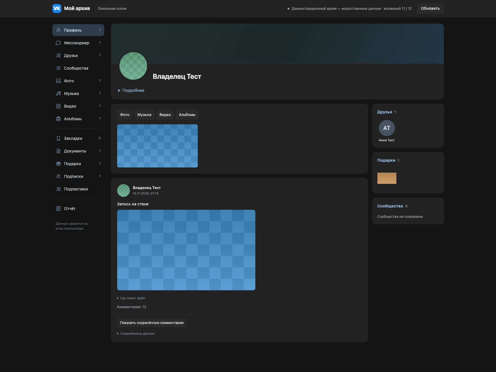

# VK Archive

Локальный архив ВКонтакте: отдельный загрузчик данных, медиа с понятными именами и независимый просмотрщик в браузере.



```text
python download.py   →   данные API + файлы + отчёт
python view.py       →   просмотр сохранённого архива без токена
```

Python **3.9+**, Windows, macOS и Linux. Основные функции используют только стандартную библиотеку. Для необязательного режима `yt-dlp` рекомендуется Python 3.11+.

Это самостоятельный неофициальный проект, не связанный с VK. Результат ограничен данными и разрешениями, которые реально предоставляет API используемому клиенту.

## Посмотреть интерфейс без аккаунта

Из исходников можно создать искусственный демонстрационный архив, без токена и сетевых запросов:

```sh
python3 -m tests.demo
python3 view.py --out archives/demo
```

На Windows используйте `py` вместо `python3`. Демо содержит тестовую переписку, изображения, аудио и документ. Существующий архив эта команда не перезаписывает.

## Быстрый старт

Скачайте исходники репозитория и распакуйте. Откройте терминал в папке с `download.py` и `view.py`. Устанавливать дополнительные пакеты для обычного запуска не нужно.

**Windows — загрузка:**

```powershell
py download.py
```

**macOS / Linux — загрузка:**

```sh
python3 download.py
```

Введите значение пользовательского `access_token`, без URL и `access_token=`. По умолчанию используется **обычный видимый ввод**, в том числе для диагностики вставки в консоли Windows. Скрытый ввод включается флагом `--hidden-token`. Для автоматического запуска можно задать переменную окружения `VK_ACCESS_TOKEN`; аргумента командной строки с токеном нет.

Загрузчик **не открывает браузер и не запускает сервер**. Он сначала собирает данные API и имена источников, затем скачивает файлы. По завершении печатает расположение отчёта и команду просмотра. Архив по умолчанию: `archives/default`.

**Windows — просмотр:**

```powershell
py view.py
```

**macOS / Linux — просмотр:**

```sh
python3 view.py
```

Также можно дважды щёлкнуть `open_viewer.bat` на Windows или запустить `open_viewer.command` на macOS. Если macOS не разрешает запуск `.command`, используйте команду `python3 view.py` в терминале.

Откроется локальная страница. Для просмотра токен и интернет не нужны. Сервер слушает только `127.0.0.1`, читает базу в режиме read-only и не запускает загрузчик. Остановка любой команды — `Ctrl+C`.

Можно открыть просмотрщик отдельно во время выгрузки, когда база уже создана: данные будут постепенно появляться по кнопке «Обновить» и при автоматическом обновлении. Во время ввода, воспроизведения медиа и чтения раскрытых исходных данных перерисовка приостанавливается.

## Где лежат файлы

Структура строится по правилу **тип → источник → название источника с ID → дата и имя файла**:

```text
archives/default/
├── archive.sqlite3
├── raw/                              # ответы API без токена
├── media/
│   ├── photos/
│   │   ├── albums/Лето__101/
│   │   │   └── 2023-11-14_22-13-20Z__Фотография__vk_42_71.jpg
│   │   ├── dialogs/Анна__50/
│   │   └── wall/Моя стена__42/
│   ├── documents/
│   │   ├── dialogs/Анна__50/
│   │   │   └── 2023-11-14_22-13-20Z__Диплом__vk_42_91.docx
│   │   └── profile/Иван Иванов__42/
│   ├── videos/
│   ├── audio/
│   ├── voice/
│   ├── avatars/
│   ├── stickers/
│   ├── gifts/
│   └── previews/
├── report.json                       # полнота обхода и ошибки
├── media_index.csv                   # все пути, источники, размеры и SHA-256
└── verify_report.json                # появляется после --verify
```

В каждой папке типа могут присутствовать `profile`, `albums`, `dialogs`, `wall`, `bookmarks`, `people`, `groups`, `gifts` и `unknown`. Если имя источника получить не удалось, сохраняется доступное обозначение и ID.

- Имена пригодны для Windows и macOS: запрещённые символы заменяются, длинные названия сокращаются со стабильным суффиксом. ID защищает от совпадения имён.
- Дата в имени — **UTC**, обозначенная `Z`. Если собственной даты у файла нет, используется дата его появления в источнике; если нет и её — `undated`. В интерфейсе дата отображается в часовом поясе браузера.
- Скачивается наибольший возвращённый API вариант фотографии. Это не гарантирует исходный файл камеры.
- У документов сохраняются доступное исходное имя и расширение. Полное название остаётся в базе и CSV, даже если файловое имя сокращено.
- Один файл, встречающийся в нескольких источниках, доступен в каждом соответствующем каталоге. Повторная загрузка не нужна: создаются **жёсткие ссылки**, а при невозможности — обычные копии. Для жёстких ссылок изменение содержимого через один путь изменяет тот же файл по другим путям.

Искать можно по типу, собеседнику/альбому, дате, названию и VK ID средствами файлового менеджера. `media_index.csv` дополнительно содержит источник и контрольную сумму каждого пути. Не переименовывайте и не перемещайте файлы внутри рабочей копии архива: просмотрщик использует сохранённые относительные пути.

## Папка другого аккаунта

Задайте одинаковый `--out` обеим командам:

```powershell
py download.py --out "D:\VK-backups\my-profile"
py view.py --out "D:\VK-backups\my-profile"
```

```sh
python3 download.py --out "$HOME/Documents/VK-backups/my-profile"
python3 view.py --out "$HOME/Documents/VK-backups/my-profile"
```

Рекомендуется достаточно короткий путь на локальном диске, особенно на Windows. Для другого пользователя выбирайте другую папку: загрузчик проверяет владельца токена до записи данных аккаунта.

## Продолжение, обновление, проверка

Повторный обычный запуск продолжает незавершённые страницы API и загрузки файлов. Готовые файлы повторно не скачиваются. Недокачанный отдельный файл начинается заново.

Чтобы повторить загрузку проблемных видео и документов после обновления проекта, запустите `download.py` с прежним `--out` и введите токен. Загрузчик попробует запросить новые адреса этих файлов. Для неполных альбомов он также попробует общий запрос фотографий профиля. `--files-only` подходит для повтора по уже сохранённым адресам без запроса новых у ВК. После обхода консоль выводит зелёную плашку со сводкой и отмечает пропуски.

```sh
python3 download.py --refresh        # повторно обойти API, получить новые сообщения
python3 download.py --metadata-only  # только данные API и очередь медиа
python3 download.py --files-only     # скачать/восстановить файлы без токена
python3 download.py --verify         # проверить все сохранённые пути по SHA-256
```

На Windows замените `python3` на `py`.

`--refresh` не удаляет ранее сохранённые объекты: архив может содержать снимки разных запусков. Пропавший основной файл восстанавливается из другой доступной ссылки на тот же объект или скачивается повторно. Быстрый повторный запуск использует сведения о размере; полная проверка содержимого выполняется отдельной командой `--verify`.

Если API-токен истёк, требуется CAPTCHA или проверка аккаунта, сбор останавливается с ошибкой. Для скачивания уже найденных файлов можно отдельно использовать `--files-only`. Обычный отказ отдельного раздела записывается в отчёт, остальные разделы продолжают обрабатываться.

В `report.json` видны состояния задач и недоступные/неполностью сохранённые медиа. `partial` означает, в частности, что сам файл сохранён, но не удалось создать некоторые пути по источникам. Повторный `--files-only` попытается их восстановить. `verify_report.json` проверяет и основной файл, и все его пути по источникам. Проверку запускайте после остановки загрузчика, чтобы не проверять промежуточное состояние.

Коды завершения загрузчика: `0` — обход завершён; `1` — критическая ошибка; `2` — обход завершён с пропусками или проверка выявила проблему; `130` — остановка пользователем. Сам факт завершения обхода не доказывает независимую полноту данных ВК.

## Что собирается и отображается

- Профиль и доступные сведения о владельце.
- Обычные и архивные диалоги, история, участники бесед, ответы, пересылки, служебные события.
- Фотоальбомы, фотографии, сохранённые фотографии, документы.
- Стена, посты, комментарии и доступные полные ветки ответов.
- Друзья, сообщества, подписки, подписчики, подарки.
- Закладки с доступным содержимым постов и страницы в закладках.
- Видео, аудио- и голосовые вложения, доступные стикеры, изображения подарков, аватары и превью.

Имена и аватары — снимки, доступные во время сбора. Неизвестные поля остаются в исходных JSON. Удалённые данные, прежние имена/аватары и недоступные оригиналы восстановить этим инструментом нельзя.

**Полная музыкальная коллекция не выгружается.** Сохраняются аудиовложения и файлы по фактически возвращённым адресам. Также не реализованы отдельные выгрузки историй, клипов, звонков, платежей, рекламного кабинета и списков лайков/реакций. Наличие метода в схеме API или права в OAuth-ссылке не гарантирует доступ конкретному токену.

PDF в эту версию не входит: просмотр выполняется через независимый локальный интерфейс.

## Ошибка сертификата при скачивании файлов

Проверьте дату и время в Windows. Если загрузчик по-прежнему выдаёт ошибку сертификата HTTPS, попробуйте системную проверку цепочки сертификатов Windows через [truststore](https://truststore.readthedocs.io/en/latest/) (Python 3.10+).

```powershell
py -m pip install truststore
py download.py --files-only --system-tls
```

Если архив находится в другой папке, добавьте прежний `--out`. Если сохранённые ссылки уже истекли и сервер возвращает HTTP 403, запустите `py download.py --system-tls` с той же папкой и токеном, чтобы запросить новые ссылки. Готовые файлы повторно не скачиваются.

`--system-tls` применяется к прямым загрузкам файлов. При повторном отказе найдите код проверки сертификата в карточке файла или `report.json`.

## Необязательная загрузка потокового видео

По умолчанию сохраняются прямые MP4, если они вернулись в API. Проигрыватель и миниатюра не считаются сохранённым видео. Для дополнительной попытки можно установить `yt-dlp` в отдельное окружение Python 3.11+:

```sh
python3 -m venv .venv
source .venv/bin/activate
python -m pip install yt-dlp
python download.py --yt-dlp
```

Windows:

```powershell
py -m venv .venv
.\.venv\Scripts\python.exe -m pip install yt-dlp
.\.venv\Scripts\python.exe download.py --yt-dlp
```

Для некоторых потоков нужен отдельно установленный `ffmpeg`. Выбирается единый готовый формат; максимальное качество с раздельными дорожками не гарантируется. Пользовательский токен и cookies браузера загрузчику видео не передаются. Внешние ограничения доступа этим режимом не обходятся.

## Диагностика токена

```sh
python3 download.py --debug-token
```

Будут показаны длина, короткий отпечаток SHA-256 и позиции управляющих/не-ASCII символов; локальная проверка формата отключается. Сервер ВК продолжит проверять авторизацию. Токен не сохраняется в архив; не включайте видимую строку ввода в публикуемые логи и скриншоты.

## Установка как пакета

Запуск из исходников не требует установки. При желании:

```sh
python3 -m pip install .
vk-archive-download --out archives/default
vk-archive-view --out archives/default
```

HTML/CSS/JS входят в пакет. Для изменения внешнего вида редактируются только файлы `vk_archive/web/`; загрузчик от них не зависит.

## Структура проекта

```text
download.py                  CLI загрузчика
view.py                      CLI просмотрщика
vk_archive/
  api.py                     запросы VK и сохранение исходных ответов
  collector.py               обход разделов API и возобновление
  media.py                   понятные пути, загрузка, ссылки и проверка файлов
  store.py                   SQLite, объекты, источники и выборки
  download_cli.py            команды загрузки и отчёты
  view_cli.py                запуск независимого просмотрщика
  server.py                  локальный HTTP-сервер чтения
  web/index.html             интерфейс
  web/app.css
  web/app.js
tests/                       тесты на искусственных данных
```

## Совместимость и резервная копия

Формат архива — **версия 2**. Старые выгрузки односоставного `vk_archive.py` не поддерживаются и не изменяются: используйте новую папку. Повторные запуски этой версии совместимы между собой.

После остановки загрузчика копируйте **всю папку архива**. Файлы SQLite WAL/SHM, если они присутствуют, не удаляйте вручную. Затем проверьте копию через `--verify` и откройте `view.py` без интернета. Для автономного использования нужны исходники/установленный пакет просмотрщика и сама папка архива.

## Разработка и GitHub

```sh
python3 -B -m unittest discover -s tests -v
python3 download.py --help
python3 view.py --help
```

Тесты не требуют токена и не обращаются к ВК; серверные тесты открывают только локальный тестовый порт. GitHub Actions настроен для Windows, macOS и Linux.

В репозиторий включаются исходники, документация и тесты. `.gitignore` исключает стандартные папки архивов, базы, медиа в корне, `.env`, файлы токенов и отчёты. Если используется произвольный `--out` внутри репозитория, добавьте эту папку в `.gitignore` до публикации.

Перед первым коммитом просмотрите `git status --short`. Проект подготовлен для размещения на GitHub, но не создаёт удалённый репозиторий и ничего туда не отправляет автоматически.

Лицензия кода: [MIT](LICENSE). Рекомендации по участию: [CONTRIBUTING.md](CONTRIBUTING.md).

## Первичные источники

- [VKCOM: схема методов и объектов API](https://github.com/VKCOM/vk-api-schema).
- [yt-dlp: установка и зависимости](https://github.com/yt-dlp/yt-dlp#dependencies).
